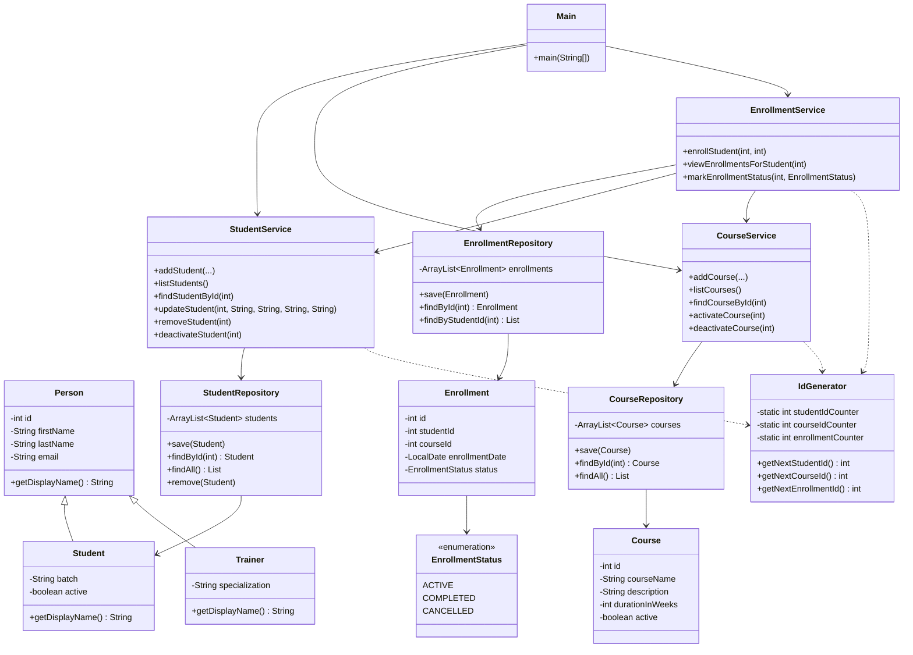

# LearnTrack

LearnTrack is a console-based Student & Course Management System built with Core Java.

Package: `airtribe.projects.learntrack`

Admins can manage:

- Students
- Courses
- Enrollments

All data is stored in memory using `ArrayList` (no database or file persistence).

## Project Structure

```text
src/airtribe/projects/learntrack/
├── ui/
│   └── Main.java
├── entity/
│   ├── Person.java
│   ├── Student.java
│   ├── Trainer.java
│   ├── Course.java
│   └── Enrollment.java
├── repository/
│   ├── StudentRepository.java
│   ├── CourseRepository.java
│   └── EnrollmentRepository.java
├── service/
│   ├── StudentService.java
│   ├── CourseService.java
│   └── EnrollmentService.java
├── exception/
│   ├── EntityNotFoundException.java
│   └── InvalidInputException.java
├── util/
│   └── IdGenerator.java
├── constants/
│   ├── MenuOptions.java
│   └── AppConstants.java
├── enums/
│   └── EnrollmentStatus.java
└── README.md
```

## Features

### Student Management
- Add new student
- View all students
- Search student by ID
- Deactivate a student (`active = false`)

Service methods also include `updateStudent` and `removeStudent`.

### Course Management
- Add new course
- View all courses
- Activate / Deactivate a course

### Enrollment Management
- Enroll a student in a course
- View enrollments for a student
- Mark enrollment as COMPLETED or CANCELLED

## How to Compile and Run

From the `Basics` project root (folder that contains `src/`):

```bash
javac -d out $(find src/airtribe/projects/learntrack -name "*.java")
java -cp out airtribe.projects.learntrack.ui.Main
```

Or compile only this package and run:

```bash
mkdir -p out
javac -d out src/airtribe/projects/learntrack/**/*.java src/airtribe/projects/learntrack/ui/Main.java
java -cp out airtribe.projects.learntrack.ui.Main
```

In IntelliJ IDEA: open the `Basics` project, run `Main.java` under `airtribe.projects.learntrack.ui`.

## Class Diagram



## Package Overview

| Package | Responsibility |
| --- | --- |
| `entity` | Domain models and inheritance (`Person` → `Student` / `Trainer`) |
| `repository` | In-memory `ArrayList` storage |
| `service` | Business logic |
| `exception` | Custom exceptions |
| `util` | ID generation (`IdGenerator`) |
| `constants` | Menu options and app constants |
| `enums` | Fixed values such as enrollment status |
| `ui` | Menu / console UI (`Main`) |
